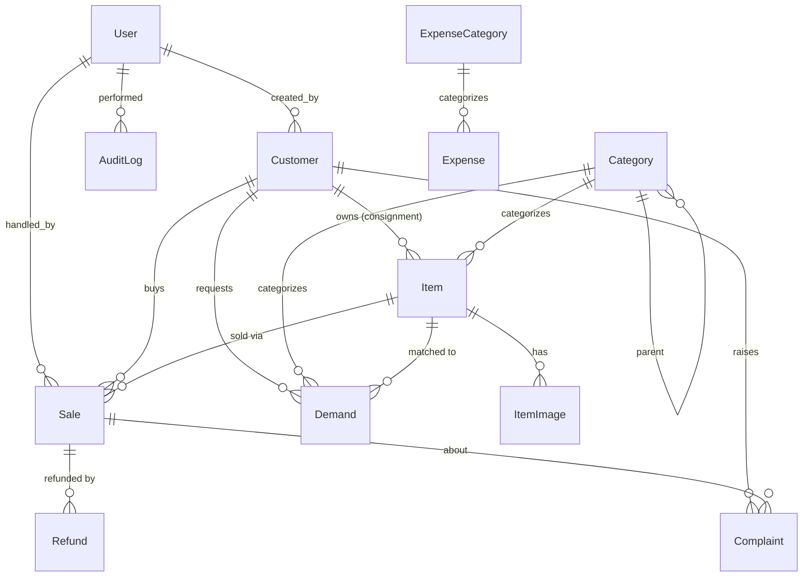

# Fududeeye CRM

Internal CRM for **Fududeeye**, a brokerage and inventory company in Galkayo, Somalia.
Tracks customers, consignment and company-owned inventory, sales, refunds, demands,
complaints, expenses, and dashboard reports.

---

## Table of contents

- [Fududeeye CRM](#fududeeye-crm)
  - [Table of contents](#table-of-contents)
  - [1. How the business works](#1-how-the-business-works)
  - [2. Repo layout](#2-repo-layout)
  - [3. Tech stack](#3-tech-stack)
  - [4. Backend apps and models](#4-backend-apps-and-models)
  - [5. Data model details](#5-data-model-details)
    - [5.1 `core` — audit infrastructure](#51-core--audit-infrastructure)
    - [5.2 `accounts.User`](#52-accountsuser)
    - [5.3 `customers.Customer`](#53-customerscustomer)
    - [5.4 `inventory`](#54-inventory)
    - [5.5 `sales`](#55-sales)
    - [5.6 `demands.Demand`](#56-demandsdemand)
    - [5.7 `complaints.Complaint`](#57-complaintscomplaint)
    - [5.8 `finance`](#58-finance)
    - [5.9 ER diagram](#59-er-diagram)
  - [6. Roles and permissions](#6-roles-and-permissions)
  - [7. Item status workflow](#7-item-status-workflow)
  - [8. Reports](#8-reports)
  - [9. API conventions](#9-api-conventions)
  - [10. Frontend overview](#10-frontend-overview)
    - [Routes](#routes)
    - [Auth flow](#auth-flow)
    - [Permission-aware UI](#permission-aware-ui)
    - [Key form behaviors](#key-form-behaviors)
    - [Visual style](#visual-style)
  - [11. Getting started — backend](#11-getting-started--backend)
  - [12. Getting started — frontend](#12-getting-started--frontend)
  - [13. Working with Claude Code / Codex](#13-working-with-claude-code--codex)
    - [Workflow](#workflow)
    - [Conventions for agents extending this project](#conventions-for-agents-extending-this-project)
    - [Where things live](#where-things-live)
    - [When asked to add a feature](#when-asked-to-add-a-feature)
    - [Things to avoid](#things-to-avoid)
  - [14. Project rules that must not be broken](#14-project-rules-that-must-not-be-broken)
    - [14a. Build plan](#14a-build-plan)
    - [14b. Completion protocol](#14b-completion-protocol)
    - [14c. What's built — snapshot](#14c-whats-built--snapshot)
    - [14d. Known gaps](#14d-known-gaps)
  - [15. Out of scope (phase 2)](#15-out-of-scope-phase-2)

---

## 1. How the business works

Read this before writing any code.

Fududeeye is a **markup brokerage**, not a percentage-commission business:

- A customer brings 2 computers and says "I want $200 per computer."
- Fududeeye lists them at $230 each (the "listed price").
- When sold for $230 → owner gets exactly $200, Fududeeye keeps $30 markup.
- If Fududeeye sells higher ($250) → owner still gets $200, Fududeeye keeps $50.
- If price drops ($220) → owner still gets $200, Fududeeye keeps $20.

The **`owner_asking_price`** is locked at the time of consignment. Fududeeye's
profit per sale is `actual_sale_price − (owner_asking_price × quantity_sold)`.

For Fududeeye's own items (~15% of inventory) there is no consignment owner.
The system stores `cost_price` instead, and profit = `sale_price − (cost_price × qty)`.

About 85% of inventory is consignment; 15% is company-owned. The owner uses
the CRM from home and office to see live state: who sold what, who is owed
money, what is pending, what customers are asking for.

---

## 2. Repo layout

```
fududeeye-crm/
├── README.md                      this file — covers backend + frontend
├── DESIGN_PROMPT.md               paste into Claude Design / Google Stitch / v0.dev
├── backend/                       Django 5 + DRF
│   ├── manage.py
│   ├── requirements.txt
│   ├── requirements-dev.txt
│   ├── .env.example
│   ├── .gitignore
│   ├── config/
│   │   ├── settings/
│   │   │   ├── base.py
│   │   │   ├── dev.py             SQLite, DEBUG=True
│   │   │   └── prod.py            PostgreSQL, hardened
│   │   ├── urls.py
│   │   ├── wsgi.py
│   │   └── asgi.py
│   └── apps/
│       ├── core/                  AuditLog, abstract models, middleware, signals
│       ├── accounts/              User with roles, DRF permission classes
│       ├── customers/             Customer
│       ├── inventory/             Category, Item, ItemImage
│       ├── sales/                 Sale, Refund
│       ├── demands/               Demand + supply matching
│       ├── complaints/            Complaint (ticket system)
│       ├── finance/               ExpenseCategory, Expense
│       └── reports/               dashboard & report endpoints (no models)
└── frontend/                      React 19 + Vite + TypeScript + Tailwind
    ├── package.json
    ├── vite.config.ts
    ├── tsconfig.json
    ├── tailwind.config.ts
    ├── index.html
    ├── .env.example
    └── src/
        ├── main.tsx
        ├── App.tsx
        ├── api/                   axios client + per-resource modules
        ├── auth/                  AuthContext, ProtectedRoute
        ├── components/            ui/, layout/, DataTable, MoneyDisplay, PermissionGate
        ├── pages/                 one folder per route group
        ├── lib/                   permissions, format, csrf helpers
        └── types/                 TS interfaces matching backend serializers
```

---

## 3. Tech stack

**Backend**
- Django 5.x + Django REST Framework
- SQLite in development, PostgreSQL in production
- Session-based auth + CSRF (CRM is internal-only)
- Local disk storage for images via Django `MEDIA_ROOT`
- USD only; English only (Somali planned later)

**Frontend**
- React 19 + TypeScript, Vite
- React Router v7
- TanStack Query (React Query) v5
- Tailwind CSS + lucide-react (shadcn/ui prerequisites installed; see G9 for decision pending)
- CSS custom properties design system: IBM Plex Sans, `#1d3480` sidebar (brand navy), `#f9a800` accent (brand gold)
- react-hook-form + zod (v4)
- axios (one shared instance)
- date-fns (v4), recharts

No Redux. No Next.js. No new state libraries or CSS frameworks.

---

## 4. Backend apps and models

| App           | Models                                                | Purpose                                                                                                |
|---------------|-------------------------------------------------------|--------------------------------------------------------------------------------------------------------|
| `core`        | `AuditLog` (+ abstract `TimestampedModel`, `AuditedModel`) | every create/update/delete on AuditedModel descendants is logged automatically via signals             |
| `accounts`    | `User`                                                | custom user with `role` ∈ {ADMIN, MANAGER, SALES}, phone, active flag                                  |
| `customers`   | `Customer`                                            | name, phone, alt phone, email, address, notes, is_active. Buyer vs seller is derived from activity      |
| `inventory`   | `Category`, `Item`, `ItemImage`                       | self-referencing categories with a `kind`; items carry `owner_asking_price` (consignment) or `cost_price` (company), plus `listed_price`, quantity, status, JSON `attributes` for category extras |
| `sales`       | `Sale`, `Refund`                                      | `Sale.save()` computes `owner_payout_amount` and `company_profit`, bumps `Item.quantity_sold`, transitions item to SOLD. Refunds are separate rows |
| `demands`     | `Demand`                                              | what a customer wants; `.suggest_matches()` returns candidate items by category + price range          |
| `complaints`  | `Complaint`                                           | ticket number `TKT-00001`, status workflow, priority, assignment                                       |
| `finance`     | `ExpenseCategory`, `Expense`                          | expenses with category, amount, payment method, receipt image                                          |
| `reports`     | (none — views only)                                   | dashboard KPIs, sales/profit/expense reports, pending payouts                                          |

Payment methods supported throughout: Cash, EVC Plus, Zaad, Bank Transfer, Other.

---

## 5. Data model details

### 5.1 `core` — audit infrastructure

**`TimestampedModel` (abstract)** — `created_at`, `updated_at`.

**`AuditedModel` (abstract, extends TimestampedModel)** — adds `created_by` and
`updated_by` (FK to User, `SET_NULL`). Populated automatically by the audit signal.

**`AuditLog` (concrete)** — immutable trail. Fields: `user`, `action`
(CREATE / UPDATE / DELETE / LOGIN / LOGOUT / CUSTOM), `model_name`, `object_id`,
`object_repr`, `changes` (JSON), `ip_address`, `timestamp`. Indexed by timestamp,
by (model_name, object_id), and by user. Nobody can edit or delete AuditLog rows.

Every concrete subclass of `AuditedModel` is logged by the signal in
`apps.core.signals` — no per-app audit code is needed.

### 5.2 `accounts.User`

Extends Django's `AbstractUser`. Adds:
- `role` ∈ `ADMIN | MANAGER | SALES` (default SALES)
- `phone`
- `is_active_staff`
- Helper properties: `is_admin`, `is_manager`, `can_view_finance`, `can_delete`.

### 5.3 `customers.Customer`

`full_name`, `phone` (indexed), `alternate_phone`, `email`, `address`, `notes`,
`is_active`. Properties `is_seller` and `is_buyer` are derived from item ownership
and purchase history — not stored as flags.

### 5.4 `inventory`

**`Category`** — self-referencing tree (`parent` FK to self). Has a `kind`
∈ `REAL_ESTATE | VEHICLE | ELECTRONICS | FURNITURE | GENERIC` which tells the UI
which extra fields to render. Unique together: (name, parent).

**`Item`** — the main inventory model.
- `title`, `description`, `category` (PROTECT FK)
- `owner_type` ∈ `COMPANY | CONSIGNMENT`
- `owner` (FK Customer, PROTECT, required when CONSIGNMENT, null when COMPANY)
- **Pricing:**
  - `owner_asking_price` — locked, consignment only
  - `cost_price` — what Fududeeye paid, company-owned only
  - `listed_price` — current marketing price (editable until sold)
- **Inventory:** `quantity`, `quantity_sold`
- `condition` ∈ `NEW | USED | REFURBISHED`
- `location`
- `status` ∈ `DRAFT | ACTIVE | RESERVED | SOLD | COMPLETED | REFUNDED | WITHDRAWN`
- `attributes` (JSONField) — category-specific extras (bedrooms, mileage, brand)

Properties: `quantity_available`, `expected_profit_per_unit`. `clean()` enforces
the consignment-vs-company rule (consignment must have owner + asking price;
company must not have owner; cost_price is for company only).

**Multiple-unit rule.** Identical items from the **same** owner go in one `Item`
row with `quantity=N`. Identical-looking items from **different** owners get
separate `Item` rows — each owner has their own locked asking price.

**`ItemImage`** — multiple per item, ordered, with `is_primary`. Stored under
`MEDIA_ROOT/items/<item_id>/`.

### 5.5 `sales`

**`Sale`** (AuditedModel)
- `item` (PROTECT), `buyer` (PROTECT FK Customer)
- `quantity_sold`, `sale_price` (total for the sale, not per unit)
- `sale_date`, `payment_method`, `handled_by` (User, PROTECT)
- **Calculated and stored at save time:**
  - `owner_payout_amount` = `owner_asking_price × quantity_sold` for consignment, else 0
  - `company_profit` = `sale_price − owner_payout_amount` (consignment) or `sale_price − (cost_price × qty)` (company)
- **Payout tracking:** `payout_status` ∈ `NA | PENDING | PAID`,
  `payout_method`, `payout_date`, `payout_handled_by`
- `notes`

`Sale.save()` is transactional. On a new sale it also bumps `Item.quantity_sold`
and transitions the item to `SOLD` if `quantity_sold >= quantity`.

**`Refund`** (AuditedModel) — separate row, preserves history.
- `sale` (PROTECT FK), `amount`, `reason`, `reason_detail`, `refund_date`,
  `item_returned`, `refund_method`, `handled_by`, `notes`

The original `Sale` row is never mutated. Reports compute net values by summing
sales and subtracting refunds.

### 5.6 `demands.Demand`

What a customer is looking for that Fududeeye doesn't yet have.

Fields: `customer`, `title`, `description`, `category` (optional),
`target_price_min`, `target_price_max`, `status` ∈ `OPEN | MATCHED | FULFILLED | DROPPED`,
`matched_item` (optional FK Item), `notes`.

Has a `.suggest_matches()` method that returns a QuerySet of candidate Items
(`status=ACTIVE`, same category if specified, listed_price within target range).
Staff confirm matches manually — no automatic linking.

### 5.7 `complaints.Complaint`

Customer complaints tracked as tickets.

Fields: `ticket_number` (auto `TKT-00001`, unique, immutable), `customer`,
`related_sale` (optional, SET_NULL), `subject`, `description`,
`status` ∈ `OPEN | IN_PROGRESS | RESOLVED | CLOSED`,
`priority` ∈ `LOW | MEDIUM | HIGH | URGENT`,
`assigned_to` (User, SET_NULL), `resolution_notes`, `resolved_at`.

On transition to RESOLVED, `resolved_at` is auto-stamped.

### 5.8 `finance`

**`ExpenseCategory`** — simple lookup (rent, utilities, salaries, marketing, …).
Just `name`, `description`, `is_active`.

**`Expense`** (AuditedModel) — `category`, `amount`, `expense_date`,
`payment_method`, `description`, optional `receipt` image, `notes`.

### 5.9 ER diagram



---

## 6. Roles and permissions

Three roles. The backend enforces these rules; the frontend hides actions the
user cannot take so they never see a button that 403s.

| Capability                       | Admin | Manager | Sales Staff |
|----------------------------------|:-----:|:-------:|:-----------:|
| Manage users (create/edit/delete)|  ✅   |   ❌    |     ❌      |
| Hard delete any record           |  ✅   |   ❌    |     ❌      |
| View all sales                   |  ✅   |   ✅    |     ✅      |
| Edit any sale                    |  ✅   |   ✅    |  own only   |
| View finance (expenses, profit)  |  ✅   |   ✅    |     ❌      |
| Record expenses                  |  ✅   |   ✅    |     ❌      |
| Approve / publish items          |  ✅   |   ✅    |     ❌      |
| Create listings                  |  ✅   |   ✅    |     ✅      |
| Edit any listing                 |  ✅   |   ✅    |  own only   |
| Handle complaints                |  ✅   |   ✅    |     ✅      |
| View audit log                   |  ✅   |   ✅    |     ❌      |
| Mark owner payout as paid        |  ✅   |   ✅    |     ❌      |

**Hard rules:**
- Nobody but Admin can hard-delete. Other roles use `WITHDRAWN` / `CLOSED` / `DROPPED` statuses.
- Sales staff see everything but only **edit their own** sales and listings.
- AuditLog entries are immutable — not even Admin can edit them.

DRF permission classes live in `apps/accounts/permissions.py`:
`IsAdmin`, `IsManagerOrAbove`, `IsFinanceViewer`, `IsStaffEditOwn`,
`DenyDeleteUnlessAdmin`.

---

## 7. Item status workflow

```
DRAFT ──(staff submits)──> ACTIVE ──(buyer commits)──> RESERVED ──(payment)──> SOLD
                              │                            │
                              └──(owner pulls)──> WITHDRAWN ┘

SOLD ──(owner paid out / company item)──> COMPLETED
COMPLETED ──(buyer returns)──> REFUNDED
```

The owner payout has its own status on the `Sale` row: `NA` (company items) →
`PENDING` (consignment, money owed) → `PAID`. The dashboard's "Pending payouts"
list is driven by `Sale.payout_status == PENDING`.

---

## 8. Reports

No new models. Endpoints aggregate from the data above.

- **Dashboard** — counts (customers, active items, open demands, open
  complaints, pending payouts); KPIs (today/week/month income, profit, refunds).
- **Owner payouts pending** — list of unpaid consignment payouts with totals.
- **Sales report** — filterable by date range, staff, category, payment method.
- **Profit report** — `sale_price − (owner_payout OR cost) − refunds`, grouped
  by day / week / month.
- **Expense report** — by category, by date range.
- **Demand vs supply** — open demands that have suggested matches.
- **Top requested** — count of demands by category, most-requested first.
- **Audit log viewer** — filterable by user, model, action, date.

---

## 9. API conventions

- Session auth (Django) + CSRF. CORS allowed for the React dev origin.
- All endpoints under `/api/v1/...`.
- Suggested resource roots: `/customers`, `/items`, `/sales`, `/refunds`,
  `/demands`, `/complaints`, `/expenses`, `/users`, `/audit-log`,
  `/reports/<name>`.
- DRF `ModelViewSet` with role-based permission classes.
- List endpoints support `?search=&ordering=&page=&page_size=`.
- Money fields serialized as decimal strings (never floats).

---

## 10. Frontend overview

### Routes

| Route                    | Page                                     |
|--------------------------|------------------------------------------|
| `/login`                 | Login                                    |
| `/`                      | Dashboard                                |
| `/customers`             | Customers list                           |
| `/customers/new`         | New customer                             |
| `/customers/:id`         | Customer detail (tabs: profile, items owned, purchases, demands, complaints) |
| `/items`                 | Items list (filters: status, category, owner_type) |
| `/items/new`             | New item (category drives extra fields shown) |
| `/items/:id`             | Item detail                              |
| `/sales`                 | Sales list                               |
| `/sales/new`             | New sale (live profit calc on right)     |
| `/sales/:id`             | Sale detail                              |
| `/sales/payouts`         | Pending payouts grouped by customer      |
| `/demands`               | Demands list                             |
| `/demands/:id`           | Demand detail (shows suggested matches)  |
| `/complaints`            | Complaints (tickets)                     |
| `/complaints/:id`        | Ticket detail                            |
| `/expenses`              | Expenses (Admin / Manager only)          |
| `/reports`               | Reports landing                          |
| `/reports/sales`         | Sales report                             |
| `/reports/profit`        | Profit report                            |
| `/audit`                 | Audit log viewer                         |
| `/users`                 | Users list (Admin only)                  |

### Auth flow

- Backend uses Django session + CSRF. Set `axios.defaults.withCredentials = true`.
- On app load: `GET /api/v1/me/` — if 401 redirect to `/login`, if 200 hydrate user context.
- Login: `POST /api/v1/auth/login/`. Logout: `POST /api/v1/auth/logout/`.
- For every non-GET request, read cookie `csrftoken` and set header `X-CSRFToken`.
  Implement once in the axios interceptor.
- API base URL: `import.meta.env.VITE_API_BASE_URL`.

### Permission-aware UI

Wrap restricted UI in `<PermissionGate role="ADMIN">…</PermissionGate>`.
Helper hooks: `useCanViewFinance()`, `useCanEdit(record)`, `useCanDelete()`.
The backend enforces the same rules independently.

### Key form behaviors

- **New item form** — choosing a category changes which extra fields render
  (real estate → bedrooms / sqm / rent vs sale; vehicle → make / model / year /
  mileage; electronics → brand / model). Choosing `owner_type=CONSIGNMENT`
  shows Customer picker + `owner_asking_price` and hides `cost_price`. Choosing
  `COMPANY` does the reverse.
- **New sale form** — picking an item shows its `listed_price` and the relevant
  base price (asking or cost) as read-only context. As the user types
  `sale_price` and `quantity_sold`, show live-calculated `owner_payout` and
  `company_profit`. Authoritative values come from the API after save.
- **Refund form** — opens from a Sale's detail; pre-fills the sale link; asks
  amount (default = full sale price), reason, refund method, and whether the
  item was returned.

### Visual style — locked

Design system chosen in session 3 from Claude Design project, re-skinned in session 4 to
match the Fududeeye brand logo (`fududeeye logo.jpeg`). Implemented in
`frontend/src/index.css` (CSS custom properties) and `frontend/tailwind.config.ts`.

**Brand palette:** deep navy `#1d3480` + amber gold `#f9a800` extracted from the company logo.

**Typography:** IBM Plex Sans (400 / 500 / 600 / 700) loaded from Google Fonts.

**Palette (CSS custom properties):**

| Token | Value | Use |
|-------|-------|-----|
| `--bg` | `#f4f6fc` | Page background |
| `--surface` | `#ffffff` | Card / panel background |
| `--surface-2` | `#f0f3fa` | Table head, input background |
| `--text` | `#0f1d42` | Body text |
| `--muted` | `#5a6b8a` | Secondary labels, table meta |
| `--divider` | `#dde2ef` | Borders between sections |
| `--accent` | `#f9a800` | Primary buttons, active indicators (brand gold) |
| `--accent-fg` | `#1d3480` | Text on gold accent background (brand navy) |
| `--accent-weak` | `#fff8e6` | Light gold tint (hover states, selected bg) |
| `--accent-dark` | `#c07800` | Darker gold for text on gold-tint backgrounds |
| `--navy` | `#1d3480` | Brand navy (info-state badge text, profit panel) |
| `--navy-weak` | `#e8ecf5` | Navy tint (Sold / Matched / In progress badge bg) |
| `--success` | `#1f7a4d` | Profit text, Resolved / Active badge fg |
| `--success-bg` | `#e7f4ec` | Active / Resolved badge background |
| `--warning` | `#b45309` | Pending payout text, Reserved / Open badge fg |
| `--warning-bg` | `#fbf0e0` | Reserved / Open badge background |
| `--danger` | `#b3261e` | High-priority / Refunded badge fg |
| `--danger-bg` | `#fbe9e7` | High-priority / Refunded badge background |
| `--radius` | `8px` | Card / table wrapper border-radius |
| `--radius-sm` | `6px` | Button / input / inner element border-radius |
| `--shadow` | `0 1px 3px rgba(15,29,66,.10), 0 1px 2px rgba(15,29,66,.06)` | Card elevation |
| `--sidebar-bg` | `#1d3480` | Brand navy sidebar background |
| `--sidebar-fg` | `#ffffff` | Sidebar foreground (icons, active text) |
| `--sidebar-text` | `#9db4da` | Inactive nav link text |
| `--sidebar-muted` | `#8ca4d4` | Sidebar secondary text (user footer role) |
| `--sidebar-active-bg` | `rgba(249,168,0,.15)` | Active nav link background (gold tint) |
| `--sidebar-active-text` | `#ffffff` | Active nav link text |
| `--sidebar-accent` | `#f9a800` | Active nav link left-border indicator (3 px, brand gold) |

**Status badge color map** (shared across all pages):

| Status | Background | Foreground |
|--------|-----------|-----------|
| Active | `#e7f4ec` | `#1f7a4d` |
| Reserved | `#fbf0e0` | `#b45309` |
| Sold | `#e8ecf5` | `#1d3480` |
| Completed | `#eaeef6` | `#1d3480` |
| Draft | `#eef2f7` | `#6b7c93` |
| Refunded | `#fbe9e7` | `#b3261e` |
| Withdrawn | `#eef2f7` | `#93a1b5` |
| Open | `#fbf0e0` | `#b45309` |
| In progress | `#e8ecf5` | `#1d3480` |
| Resolved | `#e7f4ec` | `#1f7a4d` |
| Matched | `#e8ecf5` | `#1d3480` |
| Fulfilled | `#e7f4ec` | `#1f7a4d` |
| Closed | `#eef2f7` | `#6b7c93` |

**Sidebar layout:** 228 px fixed width. Logo displayed as 34×34 white-bg rounded tile on the navy sidebar. Nav items: 9 px / 12 px padding, 6 px border-radius, 13.5 px font-size. Active item: 3 px left border `#f9a800` (gold), `rgba(249,168,0,.15)` background, weight 600, white text. Inactive: `#9db4da` text, weight 500.

**Topbar:** 60 px height, white background, search input (max-width 420 px), "New ▾" gold button (navy text), bell icon, user avatar (gold bg / navy text).

---

## 11. Getting started — backend

```bash
cd backend
python -m venv .venv
source .venv/bin/activate                 # Windows: .venv\Scripts\activate
pip install -r requirements-dev.txt
cp .env.example .env

export DJANGO_SETTINGS_MODULE=config.settings.dev
python manage.py makemigrations
python manage.py migrate
python manage.py createsuperuser
python manage.py runserver                # http://localhost:8000
```

- Django admin: <http://localhost:8000/admin/>
- API root: <http://localhost:8000/api/v1/>

For production, switch to `DJANGO_SETTINGS_MODULE=config.settings.prod` and set
the `POSTGRES_*` and `DJANGO_SECRET_KEY` values in `.env`.

---

## 12. Getting started — frontend

```bash
cd frontend
npm install
cp .env.example .env                      # set VITE_API_BASE_URL=http://localhost:8000/api/v1
npm run dev                               # http://localhost:5173
```

Both halves must be running together. CORS is allowed for
`http://localhost:5173` in dev settings.

---

## 13. Working with Claude Code / Codex

This repo is structured so an AI coding agent can read this README and build
the system.

### Workflow

1. **Backend work** — point the agent at this README (especially sections 1, 4–9,
   and 14). Ask it to scaffold the Django project, then implement one app at a
   time: `core` → `accounts` → `customers` → `inventory` → `sales` →
   `demands` → `complaints` → `finance` → `reports`.
2. **UI design** — paste `DESIGN_PROMPT.md` into Claude Design, Google Stitch,
   or v0.dev. It will produce the dashboard in three style variants. Pick one,
   then paste the chosen palette and typography into a "Visual style — locked"
   section under [§10](#10-frontend-overview).
3. **Frontend work** — point the agent at this README (especially sections 1,
   6, 9, 10, and 14). Ask it to scaffold the React project, then implement one
   route group at a time, starting with login + dashboard.

### Conventions for agents extending this project

1. **Read this README first.** If business rules in code disagree with this
   document, the document is correct — surface the conflict, don't silently
   change the doc.
2. **Money fields are `DecimalField(max_digits=12, decimal_places=2)`.** Never
   floats. Currency is USD only.
3. **All business models extend `apps.core.models.AuditedModel`.** Lookup
   tables (like `ExpenseCategory`) can skip it.
4. **Use `on_delete=PROTECT` for foreign keys to real-world entities** —
   Customer, Item, User. Use `SET_NULL` only for optional references like
   `related_sale` on Complaint.
5. **Status fields use `TextChoices` enums** defined inside the model class.
6. **No hard deletes outside the Admin role.** Add a status (WITHDRAWN /
   CLOSED / DROPPED) instead.
7. **Sale side-effects belong in `Sale.save()`** — profit/payout calculation,
   bumping `Item.quantity_sold`, transitioning `Item.status`.
8. **The audit signal lives in `apps.core.signals`** — extend it rather than
   adding ad-hoc audit code in individual apps.
9. **Tests:** every model should have at least one creation test and one
   business-rule test (e.g. profit calculation, ticket number generation).
10. **Migrations:** always run `makemigrations --check --dry-run` before
    committing schema changes.
11. **Frontend business logic:** the new-sale form may *preview* profit math,
    but authoritative numbers always come back from the API after save.
12. **Money formatting on the frontend:** use `Intl.NumberFormat('en-US',
    { style: 'currency', currency: 'USD' })`. Never JS floats.

### Where things live

- Base abstract models + AuditLog + audit signal: `backend/apps/core/`
- Custom User + permissions classes: `backend/apps/accounts/`
- Customers: `backend/apps/customers/`
- Categories, Items, ItemImages: `backend/apps/inventory/`
- Sales, Refunds: `backend/apps/sales/`
- Demands and matching: `backend/apps/demands/`
- Complaints (tickets): `backend/apps/complaints/`
- Expenses: `backend/apps/finance/`
- Reports / dashboard endpoints: `backend/apps/reports/` (no models, views only)
- Axios client + per-resource modules: `frontend/src/api/`
- Auth context: `frontend/src/auth/`
- Reusable UI: `frontend/src/components/`
- Pages: `frontend/src/pages/`

### When asked to add a feature

1. Re-read the section of this README covering the relevant app.
2. If the request conflicts with the README, surface the conflict first — do
   not silently change the design.
3. Write the model → `makemigrations` → admin registration → serializer →
   viewset → URL → test.
4. Update this README if the data model changed.

### Things to avoid

- Don't change money calculation logic in serializers or views — it belongs
  in `Sale.save()`.
- Don't bypass the audit signal.
- Don't introduce a new currency, language, or float-based money handling.
- Don't hard-delete user-facing records outside the Admin role.
- Don't put authoritative business calculations in the frontend.
- Don't introduce new state libraries (no Redux) or CSS frameworks.
- Don't bypass `<PermissionGate>` — keep permission rules in one place.

---

## 14. Project rules that must not be broken

A compressed checklist of the rules above, for quick reference:

- Money: `DecimalField(max_digits=12, decimal_places=2)`. Never floats.
- All business models extend `apps.core.models.AuditedModel`.
- FKs to real-world entities use `on_delete=PROTECT`.
- Status fields use `TextChoices` inside the model class.
- No hard deletes outside Admin role.
- AuditLog rows are immutable.
- Sale-side effects (payout calc, profit calc, item quantity, status) belong
  inside `Sale.save()`.
- Refunds are separate rows; original `Sale` rows are never mutated.
- USD only. English only.
- Frontend never holds authoritative money math.

---

### 14a. Build plan

Each milestone is atomic — mark ✅ DONE only when every acceptance check in §14b passes.
Mark ↩️ REGRESSED if a previously-done milestone's acceptance check later fails.

| # | Milestone | Status | Notes |
|---|-----------|:------:|-------|
| M0 | Project scaffold — Django 5 project, 9 apps skeleton, Vite + React 19 frontend | ✅ DONE | |
| M1 | `core` — TimestampedModel, AuditedModel, AuditLog, CurrentUserMiddleware, signals | ✅ DONE | No tests yet (pre-test-framework) |
| M2 | `accounts` — User model + 5 DRF permission classes + admin | ✅ DONE | Auth endpoints (login, logout, me) outstanding — tracked as G4; implement before M10 |
| M3 | `customers` — Customer model + full CRUD API + tests | ✅ DONE | 6 tests passing; `apps/__init__.py` added to fix pytest package discovery |
| M4 | `inventory` — Category, Item, ItemImage models + full CRUD API + tests | ✅ DONE | 18 tests passing; `clean()` enforces CONSIGNMENT/COMPANY ownership rules; serializer calls `clean()` via temp instance so API returns 400 on rule violations |
| M5 | `sales` — Sale + Refund models, Sale.save() business logic, full CRUD API + tests | ✅ DONE | 14 tests passing; Sale.save() is @transaction.atomic; all 5 named §5.5 tests pass; mark-paid action at POST /api/v1/sales/{pk}/mark-paid/ (Manager+ only) |
| M6 | `demands` — Demand model + suggest_matches + full CRUD API + tests | ⬜ TODO | |
| M7 | `complaints` — Complaint model + auto ticket numbering + full CRUD API + tests | ⬜ TODO | |
| M8 | `finance` — ExpenseCategory + Expense models + full CRUD API + tests | ⬜ TODO | |
| M9 | `reports` — dashboard KPIs + all 8 report endpoints + tests | ⬜ TODO | No new models |
| M10 | Frontend — axios client, AuthContext, ProtectedRoute, Login page | ⬜ TODO | Depends on G4 (auth endpoints) + M3 |
| M11 | Frontend — Dashboard page (live data) | ⬜ TODO | Depends on M9, M10 |
| M12 | Frontend — Customers CRUD pages | ⬜ TODO | Depends on M3, M10 |
| M13 | Frontend — Inventory pages (Category browse + Item CRUD) | ⬜ TODO | Depends on M4, M10 |
| M14 | Frontend — Sales pages + payout management | ⬜ TODO | Depends on M5, M10 |
| M15 | Frontend — Demands + Complaints pages | ⬜ TODO | Depends on M6, M7, M10 |
| M16 | Frontend — Finance + Reports pages (Admin/Manager only) | ⬜ TODO | Depends on M8, M9, M10 |
| M17 | Frontend — Users list + Audit log viewer (Admin only) | ⬜ TODO | Depends on G4, M9, M10 |

---

### 14b. Completion protocol

**Backend milestone (M3–M10) is ✅ DONE when ALL of the following hold:**

1. Every model has all fields, choices, and `on_delete` rules specified in §5.
2. `python manage.py makemigrations --check` exits 0 (no pending schema drift).
3. `python manage.py migrate` applied; `showmigrations` shows `[x]` for every migration.
4. Model(s) registered in `admin.py`; `python manage.py check` exits 0.
5. Serializer, ViewSet, and URL registered under `/api/v1/`; endpoint returns 200/201 in manual test.
6. `pytest` exits 0: at minimum one creation test + one business-rule test per model.
7. No rule from the non-negotiables above is violated (DecimalField for money, AuditedModel inheritance, PROTECT FKs, Sale.save() owns profit math, no hard-delete outside Admin).

**Frontend milestone (M11–M18) is ✅ DONE when ALL of the following hold:**

1. Every route in §10 covered by the milestone is defined in App.tsx and renders without console errors.
2. All API calls target real backend endpoints (no hardcoded or mocked data).
3. `<PermissionGate>` applied wherever §6 restricts access.
4. `npm run build` exits 0.

Mark a previously-done milestone ↩️ REGRESSED if any acceptance check above would now fail. Explain what broke in §14d and fix before advancing to the next milestone.

---

### 14c. What's built — snapshot

> Last updated: session 7 (M5 `sales` — Sale + Refund models, Sale.save() business logic, mark-paid action, 14 tests passing)

| Field | Value |
|-------|-------|
| Last completed milestone | M5 — `sales` Sale + Refund + Sale.save() profit math + mark-paid action |
| Current milestone in progress | none — ready to start M6 (demands) |
| Next milestone | M6 — Demand model + suggest_matches + full CRUD API |
| Models with migrations applied | `core`, `accounts`, `customers`, `inventory`, `sales` — `migrate` applied, all `[x]` |
| Tests passing | 38 / 38 — 6 customer + 18 inventory + 14 sales |
| Backend health | `manage.py check` → 0 issues; `makemigrations --check` exits 0 (no drift) |
| Frontend build | `npm run build` → ✓ (699 KB bundle, verified after brand re-skin) |
| Frontend pages | 11 static-data pages + shared `Layout` component: Dashboard, Items, NewSale, CustomerDetail, Demands, Complaints, Expenses, PendingPayouts, Reports, AuditLog, Users. All routes wired in `App.tsx`. Full brand design system in place: IBM Plex Sans, brand navy `#1d3480` sidebar with gold `#f9a800` active accent, complete CSS custom-property token set in `index.css`, Tailwind color extensions in `tailwind.config.ts`. **Pages use hardcoded mock data — no API calls yet.** |

---

### 14d. Known gaps

Open items that must be resolved before or during the indicated milestone.
Remove an entry once it is fixed; add new entries as they are discovered.

| # | Gap | Severity | Blocking | Resolution |
|---|-----|:--------:|:--------:|------------|
| G4 | Auth endpoints absent — §10 auth flow requires `/api/v1/me/`, `/api/v1/auth/login/`, `/api/v1/auth/logout/` which are not wired | High | M11 | M3 deliverable — now unblocked |
| G11 | User model changes (role edits, deactivation) are not tracked in `AuditLog` — `User` extends `AbstractUser` not `AuditedModel`, so the audit signal never fires for user mutations. Confirmed: editing a user's role in the shell produces 0 `AuditLog` rows. Decision needed: (a) add a dedicated `post_save` receiver for User in `core.signals`; or (b) use Django's built-in session/admin log; or (c) document as accepted gap for internal CRM. Resolve before M10 adds auth endpoints that will create, log in, and edit users. | Medium | M10 | Decide approach before M10 |
| G5 | `AuditLog.delete()` model-level guard is bypassable — Django `QuerySet.delete()` skips model `delete()`, so `AuditLog.objects.filter(...).delete()` would succeed silently | Low | — | Accepted risk for internal CRM; admin already blocks UI deletion |
| G6 | `_pre_save_state` dict in `signals.py` can accumulate stale entries if `pre_save` fires but `post_save` never follows (e.g., mid-transaction exception rolls back) | Low | — | Acceptable at CRM scale; revisit if memory pressure observed |
| G7 | `date-fns` v4 installed (v4.4.0) — timezone API changed significantly from v3; frontend date formatting must use v4 patterns | Info | M11 | Enforce v4 patterns when building date pickers and report filters |
| G8 | `zod` v4 installed (v4.4.3) — schema inference syntax changed from v3; use `z.infer<typeof schema>` with v4 `.parse()` | Info | M11 | Enforce v4 patterns when building form validation |
| G9 | `shadcn/ui` not installed — §3 lists it as a frontend dependency but it is absent from `package.json`. Only its prerequisites (`class-variance-authority`, `tailwind-merge`) are present. The frontend currently uses CSS custom properties + inline styles from the Claude Design system. Decision needed: (a) install shadcn/ui for component primitives, or (b) remove it from §3 and commit to the current design-system approach. | Medium | M11 | Decide before M11 begins |
| G10 | All 11 frontend pages use hardcoded/static mock data — they faithfully reproduce the Claude Design mockups but have zero API integration. Each page will need conversion to real API calls, `AuthContext`, and `PermissionGate` during M11–M18. | Info | M11–M18 | Each M11–M18 milestone refactors its respective pages |

---

## 15. Out of scope (phase 2)

Reserved design space — do not build yet, but don't paint into a corner:

- **Public marketplace site** where outside sellers register and buyers browse.
  Will reuse Customer, Item, Category. Will add models like `ItemReview`,
  `ItemFavorite`, `ExternalSellerAccount`.
- **Notifications** — email + SMS to buyers/sellers/staff.
- **Somali language toggle** — typography and layout should accommodate slightly
  longer translated strings.
- **Two-way mobile money integrations** (EVC Plus / Zaad APIs).
- **Bulk import via CSV/XLSX** for each model, for migrating the owner's
  existing spreadsheets on day one.

#### Milestone detail (acceptance criteria)

> **Note:** The detailed milestone numbers below (M0–M13) are from the original specification and use a different numbering than the active summary table above. Mapping: DETAIL M2 = TABLE M2 + M3 (split); DETAIL M3 = TABLE M4; DETAIL M10 = TABLE M11; DETAIL M11 = TABLE M12–M18. Use the **table above** for current status tracking.

Build in this order. Do not move to the next milestone until the current one
passes its acceptance check. After completing a milestone, stop and wait for
the next instruction.

### M0 — Repo scaffold
- Create `backend/` and `frontend/` exactly per §2.
- Backend: Django 5 project `config` with split settings (dev/prod), nine
  empty apps registered (core, accounts, customers, inventory, sales,
  demands, complaints, finance, reports), DRF + CORS + django-filter
  configured, `/api/v1/` placeholder route.
- Frontend: Vite + React + TS + Tailwind + shadcn prerequisites, providers
  for React Router and TanStack Query, placeholder home route.
- **Accept when:** `python manage.py check` clean, `makemigrations --dry-run`
  shows no models yet, `npm run build` succeeds.

### M1 — `core` (audit foundation)
- Implement `TimestampedModel`, `AuditedModel`, `AuditLog`, the
  `CurrentUserMiddleware`, and the post_save / post_delete signals exactly
  per §5.1.
- Register `AuditLog` in admin as read-only.
- **Accept when:** creating any AuditedModel subclass in a shell session
  produces an AuditLog row with the right user, model_name, and action.

### M2 — `accounts` (User + permissions)
- Custom `User` per §5.2. Set `AUTH_USER_MODEL`.
- `apps/accounts/permissions.py` with the five DRF permission classes
  named in §6.
- Endpoints: `GET /api/v1/me/`, `POST /api/v1/auth/login/`,
  `POST /api/v1/auth/logout/`, `GET /api/v1/users/` (Admin only).
- **Accept when:** logging in via the API returns a session cookie and
  `/me/` reflects the current user.

### M3 — `customers`
- `Customer` model per §5.3, admin, serializer, ModelViewSet at
  `/api/v1/customers/`, basic test (create + list).
- **Accept when:** a Sales user can create and list customers; phone is
  searchable.

### M4 — `inventory` (Category, Item, ItemImage)
- All three models per §5.4 including the JSON `attributes`, the
  `clean()` validation for consignment vs company, and the multi-image
  upload endpoint.
- Endpoints under `/api/v1/categories/` and `/api/v1/items/` with filters
  for status, category, owner_type.
- **Accept when:** creating a CONSIGNMENT item without an owner is rejected;
  creating a COMPANY item with an owner is rejected.

### M5 — `sales` (the money-math heart)
- `Sale` and `Refund` per §5.5. `Sale.save()` must compute payout and
  profit, bump `Item.quantity_sold`, transition `Item.status` to SOLD when
  stock hits zero, set `payout_status=PENDING` for consignment.
- Endpoints: `/api/v1/sales/`, `/api/v1/refunds/`, plus a
  `/api/v1/sales/payouts-pending/` listing.
- Mark-payout-paid action: `POST /api/v1/sales/{id}/mark-paid/`.
- **Tests (required for this milestone):**
  - Profit calc for consignment, single unit
  - Profit calc for consignment, multiple units
  - Profit calc for company-owned
  - Item.status transitions to SOLD when last unit sold
  - Refund creates a new row without mutating the Sale
- **Accept when:** all five tests pass.

### M6 — `demands`
- `Demand` per §5.6 with `.suggest_matches()`.
- Endpoint `GET /api/v1/demands/{id}/suggested-matches/`.
- **Accept when:** creating a Demand with a price range returns only
  ACTIVE items inside that range in the suggestions.

### M7 — `complaints`
- `Complaint` per §5.7 with auto-generated `TKT-00001` numbering.
- Endpoints under `/api/v1/complaints/`.
- **Accept when:** the third complaint created has `ticket_number =
  TKT-00003`; transitioning to RESOLVED stamps `resolved_at`.

### M8 — `finance`
- `ExpenseCategory` and `Expense` per §5.8.
- Endpoints under `/api/v1/expense-categories/` and `/api/v1/expenses/`,
  restricted to Admin and Manager.
- **Accept when:** a Sales user gets 403 trying to list expenses.

### M9 — `reports`
- Dashboard endpoint `GET /api/v1/reports/dashboard/` returning the KPIs
  and lists described in §8.
- Sales report, profit report, expense report endpoints.
- **Accept when:** dashboard JSON includes today's sales count, profit,
  pending-payouts total, open complaints, open demands, and recent sales.

### M10 — Frontend foundation
- `axios` client with CSRF interceptor, `AuthContext`, `ProtectedRoute`,
  `AppShell` (sidebar + topbar), `PermissionGate`, `DataTable`,
  `MoneyDisplay`, `StatusBadge`.
- Routes: `/login`, `/` (dashboard skeleton calling
  `/api/v1/reports/dashboard/`).
- **Accept when:** a real user can log in via the React app, see the
  dashboard KPIs from the API, and log out.

### M11 — Frontend per-resource pages
Roll out in this order, each its own milestone:
1. Customers (list, new, detail with tabs)
2. Items (list, new with category-driven extra fields, detail)
3. Sales (list, new with live profit preview, detail, payouts page)
4. Demands (list, detail with suggested matches)
5. Complaints (list, ticket detail)
6. Expenses (list, new) — gated by `useCanViewFinance()`
7. Reports (sales, profit, expense)
8. Audit log viewer
9. Users (Admin only)

### M12 — Visual style lock + polish
- Paste the chosen mockup's palette and typography into the
  "Visual style — locked" subsection of §10.
- Update `tailwind.config.ts` to match.
- Pass a responsive audit at 375px width.
- **Accept when:** dashboard, items list, and new-sale form match the
  approved mockups on both desktop and mobile.

### M13 — Production hardening (last)
- Switch `DJANGO_SETTINGS_MODULE` to `config.settings.prod`, set up
  PostgreSQL, run migrations, configure static + media file serving,
  gunicorn + nginx (or platform equivalent), HTTPS, environment variables.
- Smoke-test all milestones against the production deployment.